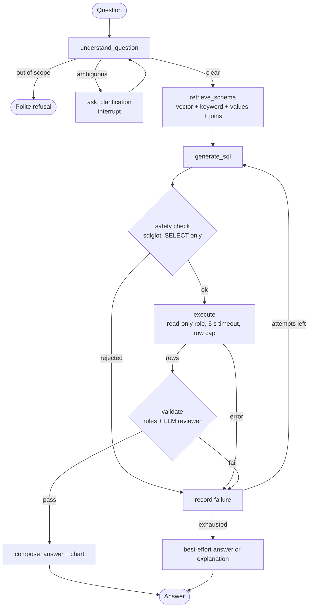

# Text-to-SQL Agentic Bot

Ask questions about your own data in plain English. An LLM writes PostgreSQL, the agent checks it, runs
it read-only, validates the result, and when something is wrong feeds the failure back and retries.
Built on free tiers only (Groq + Gemini LLMs, a local Docker Postgres, a local embedding model).

Design and decisions: [docs/DESIGN.md](docs/DESIGN.md) · Status: **M1 to M8 complete** (M9, scaling to larger schemas, is optional and not started)

## What it does

- **Chat UI** (Streamlit): answer, an automatic chart when the result suits one, the result table, the
  exact SQL, and the full agent trace (every attempt and why a failed one was rejected).
- **Self-correcting agent** (LangGraph): SQL safety check → read-only execution → deterministic result
  checks + an LLM reviewer → retry with the error or critique, up to 3 attempts.
- **Clarification**: ambiguous questions ("who are our best customers?") pause the graph and ask one
  question with options; questions the data cannot answer are declined politely.
- **Schema retrieval**: hybrid vector + keyword search at column level, a value index (so "UK" finds
  `United Kingdom`), a business glossary, and join-path completion, so only the relevant tables reach
  the prompt.
- **Bring your own data**: PostgreSQL plain-SQL dumps, CSV and Excel files. Types are inferred,
  relationships between tables are detected and confirmed by you, sensitive-looking columns
  (`password`, `token`, …) are hidden automatically, and descriptions can be drafted by the LLM.

## Architecture



LLM calls go through one LiteLLM router (Groq primary, Gemini fallback, per-minute limits so a free-tier
quota is never hit by surprise). Each uploaded dataset lives in its own Postgres database; LLM-written SQL
only ever runs as a read-only role that can see just the exposed columns.

## Quickstart

Requires Docker and Python 3.11.

```bash
cp .env.example .env              # set the passwords and GROQ_API_KEY / GEMINI_API_KEY (both are free)
docker compose up -d --wait       # Postgres 18 + pgvector on 127.0.0.1:5433
python -m venv .venv
.venv/Scripts/pip install -r requirements.txt     # Windows (Linux/macOS: .venv/bin/pip)
.venv/Scripts/python -m app.datasets.cli load sample_data/pagila/pagila.sql.gz --name Pagila \
    --descriptions sample_data/pagila/descriptions.yaml
.venv/Scripts/python -m streamlit run app/ui/streamlit_app.py
```

Free API keys: [Groq](https://console.groq.com/keys) and [Gemini](https://aistudio.google.com/apikey).
The first question downloads the ~130 MB embedding model and builds the dataset's search index.

## Using your own data

In the app, open **Upload data**: drop in CSV / `.xlsx` / `.sql` files, review the inferred column types
and detected relationships, load, and optionally let the AI draft descriptions you can edit.

From the command line:

```bash
.venv/Scripts/python -m app.datasets.cli load customers.csv orders.csv --name "My Shop"
.venv/Scripts/python -m app.datasets.cli load book.xlsx --name Sales        # one sheet = one table
.venv/Scripts/python -m app.datasets.cli load mydb.sql --name "My DB" --hide customers.phone
.venv/Scripts/python -m app.datasets.cli describe my_shop --auto            # LLM-drafted descriptions
.venv/Scripts/python -m app.datasets.cli list
.venv/Scripts/python -m app.datasets.cli delete my_shop
```

Export a Postgres database with `pg_dump --format=plain --no-owner --no-privileges -f mydb.sql mydb`.
Custom-format dumps are not supported. Dumps are parsed by the app itself, never run through `psql`; see
[DESIGN.md §15.4](docs/DESIGN.md#154-safety-for-dumps).

Ask from the terminal instead of the UI:

```bash
.venv/Scripts/python -m app.ask --dataset pagila "Which film category earned the most revenue?"
```

## Evaluation

60 questions on the Pagila sample with hand-verified gold SQL: 40 in [eval/questions.yaml](eval/questions.yaml)
that the prompts and validators were developed against, and 20 held-out in
[eval/questions_heldout.yaml](eval/questions_heldout.yaml). Scoring is execution accuracy.

| Pagila, `gpt-oss-120b`, max 3 attempts | Main (40, in-sample) | Held-out (20) |
|---|---|---|
| M3: full schema, no retrieval | 40/40 (single-shot 36/40) | not run |
| **M8: retrieval + descriptions** | **40/40** (single-shot 39/40) | **20/20** (single-shot 20/20) |
| Schema tables sent per question | 8.7 of 24 | 9.0 of 24 |
| Retrieval coverage (all needed tables sent) | 38/40 | 20/20 |
| Validator rejections (false rejections) | 1 (0) | 3 (3, all on one question) |

Read the caveats in [DESIGN.md §10](docs/DESIGN.md#10-evaluation-suite): the 40-question set is
in-sample (two fixes were made after seeing its failures), the held-out set is the fairer number, runs vary
a little because LLM output is not fully deterministic, and 60 questions on a ~15-table schema is a small
benchmark.

```bash
.venv/Scripts/python -m eval.run_eval --delay 3                       # main set, ~15 min on free tiers
.venv/Scripts/python -m eval.run_eval --delay 3 --questions heldout
.venv/Scripts/python -m eval.retrieval_eval                           # retrieval coverage, no LLM calls
```

## Security model

- LLM-written SQL passes a `sqlglot` SELECT-only check, then runs as `bot_reader`: read-only, 5 s timeout,
  `SELECT` only on exposed columns, inside a read-only transaction, through a row-capped cursor.
- User text and LLM-derived text are always placed in delimited blocks, never in instructions.
- Uploaded data is loaded with `COPY` (never as SQL text) by a non-superuser into an isolated database.
- Secrets live in `.env`, which is git-ignored.

Details: [DESIGN.md §7](docs/DESIGN.md#7-safety) and [db/README.md](db/README.md).

## Tracing (optional)

Set `LANGSMITH_TRACING=true` and `LANGSMITH_API_KEY` in `.env` to trace every graph node and LLM call in
[LangSmith](https://smith.langchain.com). It is off by default and nothing is sent otherwise.

## Tests

```bash
.venv/Scripts/python -m pytest          # unit + integration (needs the database); no LLM quota used
.venv/Scripts/python -m pytest -m llm   # one live end-to-end LLM test (uses API quota)
```

The agent and UI tests use a scripted fake LLM, so the suite costs nothing to run.
