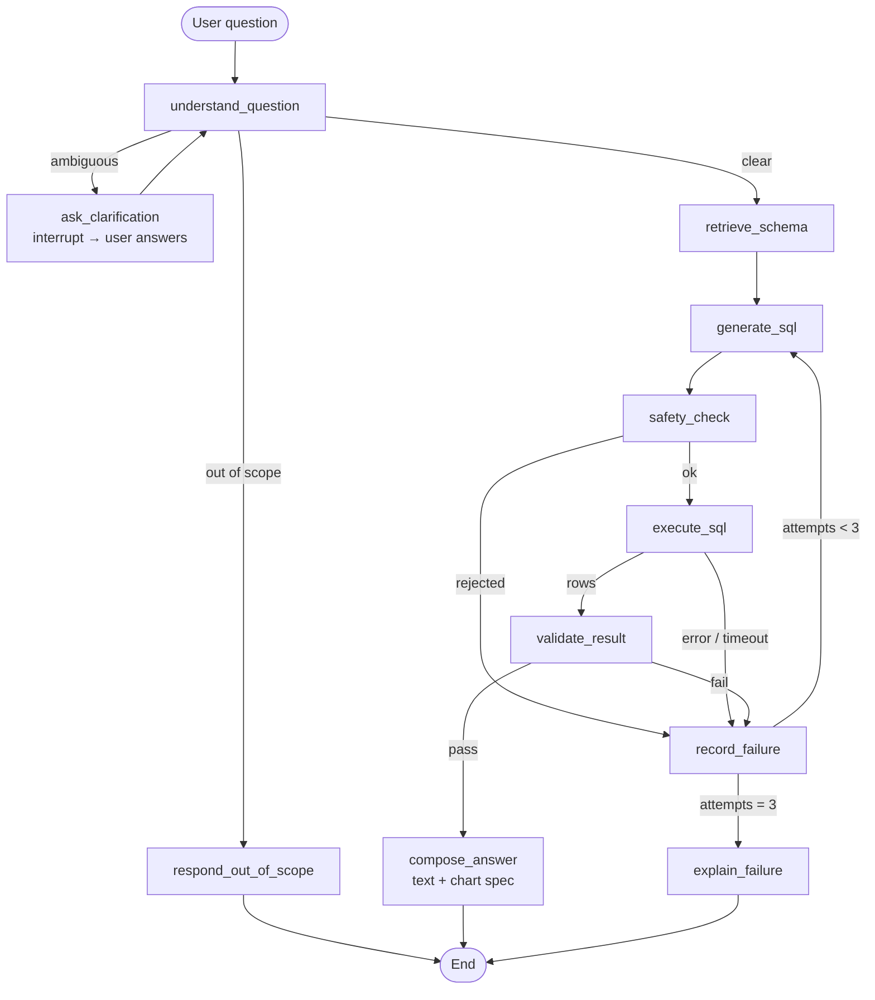

# Text-to-SQL Agentic Bot — Design Document

> Status: **Approved, in implementation** · Last updated: 2026-10-31

## 1. Overview

A chat bot that answers natural-language questions about **the user's own data**. The bot ships with no
data: users load datasets (PostgreSQL dumps now; CSV and Excel in M7), and each one becomes a PostgreSQL
database the bot can query. An LLM writes SQL, the
system executes it, a validator checks the result, and if anything goes wrong the agent feeds the failure
back to the LLM and retries (max 3 attempts). Successful results are turned into a written answer plus an
automatically chosen chart.

### Goals
- Portfolio/learning project that clearly demonstrates **agentic self-correction**.
- Runs fully locally with `docker compose up`, using **free-tier resources only**.
- Every step is visible: generated SQL, each retry, why it failed, how it was fixed.
- Accuracy claims are backed by a measured evaluation suite.

### Non-goals (for now)
- Multi-turn follow-ups ("now break that down by month") — each question is independent.
  The only multi-turn interaction is the agent asking a clarifying question.
- Write operations (INSERT/UPDATE/DELETE). The bot is strictly read-only.
- Cloud deployment, auth, multi-user support, CI.

## 2. Decision Summary

| Area | Decision |
|---|---|
| Language / agent framework | Python 3.11+, **LangGraph** (LangChain model integrations) |
| UI | **Streamlit** chat app |
| Database | **PostgreSQL 18 in Docker**, image `pgvector/pgvector:pg18` (current Pagila requires PG18) |
| Data | **Bring your own** (Section 15). No built-in dataset. **Pagila** ships in `sample_data/pagila/` as a sample to load like any other upload, and is the reference dataset for the eval suite. AdventureWorks possible later (Section 14) |
| LLM routing | **LiteLLM Router** (in-process SDK): **Groq** primary → **Gemini** fallback, rate-limit aware |
| Embeddings | Pluggable: **sentence-transformers (local)** vs **Gemini embeddings** — pick via eval |
| Vector store | **pgvector** in the same Postgres container, separate schema |
| Max attempts | **3**, then explain what was tried and ask the user to rephrase |
| Extra features | Clarifying questions (policy in Section 4.3), auto charts, agent trace in UI |
| Observability | **LangSmith** tracing (free tier) |
| Evaluation | Gold question set + scoring script |
| Deployment | Local `docker compose` only |

## 3. Architecture

```
┌────────────────────────── docker compose ──────────────────────────┐
│                                                                    │
│  ┌──────────────────────┐          ┌─────────────────────────────┐ │
│  │  app (Streamlit)     │  SQL     │  postgres (pgvector:pg18)   │ │
│  │  ├─ LangGraph agent  │ ───────▶ │  ├─ db app      : rag schema│ │
│  │  ├─ LiteLLM router   │ readonly │  │   (registry, vectors)    │ │
│  │  ├─ safety checker   │   role   │  ├─ db ds_pagila: dataset   │ │
│  │  ├─ dataset loader   │          │  └─ db ds_<slug>: dataset … │ │
│  │  ├─ embeddings       │          └─────────────────────────────┘ │
│  │  └─ chart renderer   │                                          │
│  └──────────┬───────────┘                                          │
└─────────────┼──────────────────────────────────────────────────────┘
              │ HTTPS
     ┌────────┴─────────┬──────────────────┬─────────────┐
     ▼                  ▼                  ▼             ▼
   Groq API        Gemini API        Gemini Embed    LangSmith
  (primary LLM)   (fallback LLM)    (optional)      (tracing)
```

## 4. Agent Graph (LangGraph)



### 4.1 State

```python
class Attempt(TypedDict):
    n: int                    # 1..3
    sql: str
    status: Literal["unsafe", "db_error", "timeout", "duplicate",
                    "validation_failed", "passed"]
    error: str | None         # DB error message / safety reason
    critique: str | None      # validator feedback
    row_count: int | None
    duration_ms: int
    llm_provider: str         # "groq" | "gemini" — shows fallback in trace

class AgentState(TypedDict):
    question: str
    clarifications: list[tuple[str, str]]   # (agent question, user answer)
    assumptions: list[str]                   # stated in the final answer
    relevant_schema: str                     # DDL snippet sent to the LLM
    attempts: list[Attempt]
    result: ResultSet | None                 # columns, rows (capped), dtypes
    answer: str | None
    chart_spec: ChartSpec | None
    outcome: Literal["answered", "clarifying", "out_of_scope", "gave_up"]
```

### 4.2 Nodes

| Node | LLM? | Responsibility |
|---|---|---|
| `understand_question` | yes | Classify as `clear` / `ambiguous` / `out_of_scope` using the policy in Section 4.3. If ambiguous, produce one clarifying question + 2–4 suggested options. If clear but with a minor assumption, record it in `assumptions`. Max **2** clarification rounds, then proceed with best interpretation. |
| `ask_clarification` | no | LangGraph `interrupt()` — pauses the graph; the UI shows the question and option buttons, and the user's reply resumes it (`Command(resume=...)`). Needs a checkpointer (in-memory) and a per-chat `thread_id`. |
| `retrieve_schema` | no | Embedding search for relevant tables (Section 6) → DDL snippet with descriptions and sample values. |
| `generate_sql` | yes | Produce `{reasoning, sql}` as structured output. On retries the prompt includes all previous attempts and their failures. |
| `safety_check` | no | Static checks with `sqlglot` (Section 7). Rejection counts as a failed attempt. |
| `execute_sql` | no | Runs under the read-only role, in a read-only transaction, with a timeout and row cap. |
| `validate_result` | partly | Deterministic checks first, then an LLM judge (Section 5.2). |
| `record_failure` | no | Appends the attempt and decides retry vs give up. |
| `compose_answer` | yes | One call returns the written answer **and** a chart spec. |
| `explain_failure` | no | Templated message: what was tried, why each attempt failed, suggested rephrasings. Full trace attached. |

### 4.3 Clarification policy

`understand_question` lists the plausible interpretations of the question, then applies this rule:

1. If the dataset's glossary (Section 6.1) defines the term, use that definition. **Don't ask.**
2. If all plausible interpretations produce the **same result** (or trivially different ones),
   **assume** the most natural reading and **state it** in the answer.
3. If the interpretations produce **materially different results**, meaning different rankings, different
   numbers, or different tables, **ask** one question with 2–4 options.

| Question | Interpretations | Action |
|---|---|---|
| "Who are our best customers?" | by total spend (`SUM(payment.amount)`) vs by number of rentals (`COUNT(rental_id)`). These give different rankings. | **Ask** |
| "Which store performs better?" | revenue vs rental count vs customer count | **Ask** |
| "What's our total revenue?" | glossary defines revenue = `SUM(payment.amount)` | **Glossary**, no question |
| "Top 5 most rented films" | only nuance: ties at rank 5 | **Assume**: "Ties broken alphabetically" |
| "Monthly rentals" | which year? The data covers only a few months | **Assume**: "Showing all months in the dataset" |

## 5. The Self-Correction Loop

### 5.1 Failure taxonomy

| Code | Failure | Detected by | Feedback sent to the LLM |
|---|---|---|---|
| F1 | Unsafe / non-SELECT / multiple statements | `safety_check` | The rule violated |
| F2 | Syntax or DB error (e.g. undefined column) | Postgres | Error message + **the actual columns of the tables referenced** (re-fetched from the catalog) |
| F3 | Timeout | Postgres `statement_timeout` | "Query too slow; avoid cross joins / add filters" |
| F4 | Duplicate query | Normalized SQL hash | "You produced the same query as attempt N, which failed because …" |
| F5 | Filter literal not in data (`WHERE city = 'NY'`) | Literal check (5.2) | Closest real values: `'New York'`, … |
| F6 | Runs, but result doesn't answer the question | LLM judge | Judge's critique |

### 5.2 Result validation

Deterministic checks run first. They are cheap and need no LLM call:
1. **Empty result.** Extract equality and `IN` literals from the `WHERE` clause with `sqlglot`. For each one,
   check whether the value exists in the column. If it doesn't, look up the nearest matches (`ILIKE` or
   `pg_trgm` similarity) → F5.
2. **Degenerate result.** For example, every value is NULL, or a single row of NULL from an aggregate.
3. **Row explosion.** The query joins tables but returns implausibly many rows relative to the base table,
   which usually means a missing join condition.

If those pass, an **LLM judge** receives the question, the SQL, the column names and a few sample rows.
It answers `{verdict: pass|fail, critique}`. An empty result can still pass if the judge agrees that
"no rows" is a correct answer.

### 5.3 Loop rules
- **3 attempts total.** An attempt is any generated SQL, whether it was rejected, errored, or failed
  validation.
- SQL is normalized (parsed by `sqlglot`, then pretty-printed) and hashed. A duplicate is never executed
  again.
- If attempt 3 **executed** but failed only the LLM judge, show the result as a **best-effort answer with a
  visible warning** rather than discarding it.
- If attempt 3 failed outright, run `explain_failure`.

### 5.4 LLM call budget per question (free-tier critical)

| Scenario | Calls |
|---|---|
| Best case (first try passes) | understand 1 + generate 1 + judge 1 + answer 1 = **4** |
| Worst case (3 failed attempts) | 1 + 3 × (generate + judge) = **7** |
| With 1 clarification round | +1 |

Ways to keep this low: deterministic validation runs before the judge, the judge is skipped when
F1–F5 already failed, answer and chart come from one combined call, and a small/fast model can serve as
the judge.

## 6. Schema Grounding & Retrieval

### 6.1 Schema catalog
Built per dataset from what `bot_reader` can see in that dataset's database (so hidden columns never
reach the LLM):
- Tables, views, columns, types, primary keys, foreign keys.
- Partition child tables are excluded (e.g. Pagila's `payment_p2022_01` … `payment_p2026_07`); only the
  parent (`payment`) is listed.
- **Sample values**: for text columns with low cardinality (≤ 50 distinct values), store up to 10
  distinct values.
- **Business descriptions** per dataset, stored in `rag`. They are LLM-drafted and user-edited for
  uploads (Section 15.3), or imported from a descriptions file such as the hand-written
  `sample_data/pagila/descriptions.yaml`:
  ```yaml
  tables:
    rental:
      description: One row per DVD rental transaction.
      columns:
        return_date: NULL means the DVD has not been returned yet.
  glossary:
    revenue: SUM(payment.amount)
    active customer: customer.activebool = true
  ```
  This is one of the highest-impact accuracy improvements. LLMs are good at SQL but don't know your
  business definitions.

### 6.2 Retrieval
- Index one document per table: name, description, column names/descriptions, glossary terms that mention
  it.
- For each question: embed it, take the **top-k tables** (k = 5), then **expand along foreign keys** by one
  hop. This adds the join tables (`film_actor`, `inventory`) that questions rarely mention.
- Render the selected tables as `CREATE TABLE` DDL with comments and sample values, and send that to the
  LLM.

### 6.3 Embedding providers (to be compared)

```python
class Embedder(Protocol):
    name: str
    dim: int
    def embed(self, texts: list[str]) -> list[list[float]]: ...
```

| Provider | Default model | Notes |
|---|---|---|
| `local` | `BAAI/bge-small-en-v1.5` (384-d) or `all-MiniLM-L6-v2` | No quota; adds roughly 1 GB (torch, CPU wheels) to the image |
| `gemini` | Current Gemini embedding model (verify name at build time) | Uses the Gemini quota that is also the LLM fallback |

Vectors live in `rag.schema_docs_<provider>`, one table per provider because the dimensions differ.
`scripts/build_index.py --provider local|gemini` builds an index. The active provider is chosen in `.env`
or the sidebar.

**Selection method:** the eval suite (Section 10) reports **table recall@k** for each provider, plus a
**no-retrieval baseline** that sends the full schema. With only ~15 tables the baseline may win, and that
is a valid finding worth reporting.

## 7. Safety

Defense in depth. Each layer assumes the one before it failed.

1. **Read-only DB role** `bot_reader`: per dataset, `CONNECT` plus `SELECT` on exposed tables/columns
   only. It can't connect to the `app` database (`rag` schema) or to `postgres`/`template1`, and can't
   call functions that come from dumps. Role-level `default_transaction_read_only = on`,
   `statement_timeout = 5s`.
2. **Static check (`sqlglot`)**:
   - The input must parse as exactly **one** statement.
   - The root must be `SELECT` (CTEs allowed). Reject DDL/DML anywhere in the tree.
   - Deny-list dangerous functions: `pg_sleep`, `pg_read_file`, `pg_ls_dir`, `lo_import`, `dblink`,
     `pg_terminate_backend`, `set_config`, …
   - Reject `SELECT … INTO` and the `pg_catalog` / `information_schema` / `rag` schemas.
3. **Row cap**: run the query through a server-side cursor (`DECLARE … CURSOR FOR`) and fetch at most 1000 + 1 rows. The SQL is never rewritten, so the user sees exactly what ran, and Postgres itself rejects anything that is not a query. Results over the cap are flagged as truncated.
4. **Execution** inside `BEGIN READ ONLY … ROLLBACK`.
5. **Prompt hygiene**: the user question is placed in a delimited block, never interpolated into
   instructions. Prompt injection ("ignore instructions and drop tables") is expected, and layers 1–4
   make it harmless.

## 8. LLM Layer

All LLM calls go through one function, `app.llm.client.call(group, messages, schema)`, backed by a
**LiteLLM `Router`** used in-process as a Python SDK. No separate proxy container is needed.

- **Model groups** (built in `app/llm/client.py` from settings; all model names overridable in `.env`):

  | Group | Primary (Groq) | Fallback (Gemini) | Used by |
  |---|---|---|---|
  | `generator` | `groq/openai/gpt-oss-120b` | `gemini/gemini-3.5-flash` | `understand_question`, `generate_sql`, `compose_answer` |
  | `judge` | `groq/openai/gpt-oss-20b` | `gemini/gemini-3.5-flash-lite` | `validate_result` (M3) |

  Chosen on 2026-10-31 from the providers' live model lists and a test of each candidate.
  `gemini-2.5-flash` is retired, and `gemini-3.8-flash` timed out on the free tier.
- **Free-tier protection**: `routing_strategy="usage-based-routing-v2"` with per-deployment limits. Groq
  reports **1,000 requests/day** and **8,000 tokens/min** per model, so the config uses `rpm=30` and
  `tpm=7000` for headroom. Gemini gets `rpm=10`.
  - Verified: once a deployment's token usage in the current minute exceeds its `tpm`, the next call
    goes straight to the fallback, with no 429. The check counts *past* usage, so the call that crosses
    the limit still goes through.
  - Usage counters are **per process**. The Streamlit app and the eval runner are single long-lived
    processes. Across separate CLI runs, a real 429 from Groq also triggers the fallback.
  - `num_retries=0`: a rate-limited provider is never retried, the call falls back instead.
    `allowed_fails=1` and `cooldown_time=60` take a failing deployment out of rotation for a minute.
- **Structured output**: Pydantic schemas are passed as `response_format` (JSON schema mode), and replies
  are validated with Pydantic. A reply that fails validation gets one repair round, then raises `LLMError`.
  - Measured on Groq: schema mode was 5/5 reliable for all three candidate models with realistic
    prompts. A trivial prompt made `gpt-oss-20b` fail Groq's server-side JSON check
    (`json_validate_failed`), which the router handled by falling back to Gemini.
- **Sampling**: `temperature=0` on Groq. Gemini 3+ deprecates sampling parameters, so none are sent.
- **Fallback visibility**: each call returns the deployment that actually answered (from
  `response._hidden_params["model_id"]`) and a `fell_back` flag, shown in the CLI output and later in the
  trace.
- **Tracing** (M8): `call()` gets LangSmith `@traceable(run_type="llm")`, so LLM calls nest under their
  LangGraph node.
- Gemini embeddings (Section 6.3) can also go through `litellm.embedding`, keeping one client for all
  remote AI calls.
- **Supply chain**: `litellm` is pinned to an exact version that had been public for at least a week
  when chosen (`1.106.2`, released 2026-10-21). Move to a hashed lockfile once dependencies settle.
- **Result payload to the LLM** (`app/llm/result_format.py`): column names and types, total row count
  (flagged if truncated), the first 20 rows, and min/max/sum/avg for numeric columns when rows were left
  out. ID-like and year columns are excluded from statistics. Never the full result.
- `compose_answer` is instructed to use **only numbers present in the result payload**.
- **Refusals**: `generate_sql` may return an empty `sql` with an explanation (e.g. for "delete all
  payments"). The pipeline reports this as `declined`; M5 moves it up front into `understand_question`.

## 9. Streamlit UI

```
┌─ Sidebar ─────────────┐ ┌─ Chat ─────────────────────────────────────────┐
│ LLM: Groq ● Gemini ○  │ │ 🧑 Which film category earned the most in 2022? │
│ Embeddings: [local ▾] │ │ 🤖 Sports earned the most: $5,314 ...           │
│ Retrieval k: [5]      │ │    [📊 bar chart: revenue by category]          │
│ Sample questions ▸    │ │    ▸ Result table (16 rows)                     │
│ Reset chat            │ │    ▸ SQL                                        │
└───────────────────────┘ │    ▸ Agent trace (2 attempts)                   │
                          │       ✗ #1 db_error: column "name" is ambiguous │
                          │       ✓ #2 passed (groq, 412 ms)                │
                          └─────────────────────────────────────────────────┘
```

- **Clarification**: the agent's question appears with option buttons and a free-text box. The reply
  resumes the paused graph.
- **Charts**: `compose_answer` returns
  `ChartSpec{type: bar|line|pie|scatter|table, x, y, color?, title}`. Code checks it against the result's
  column dtypes, so `line` requires a date or ordered x and `pie` requires ≤ 8 categories. If the check
  fails, the UI shows the table instead. Rendered with Plotly.
- Each trace entry shows SQL, status, error or critique, duration and provider.

## 10. Evaluation Suite

**Purpose:** measure, compare, and prove. It doesn't change runtime behavior.

- The eval runs against the **Pagila sample**, loaded as dataset `pagila` from `sample_data/pagila/`
  through the normal loader. The runner checks that it's loaded and tells you the load command if not.
- `eval/questions.yaml` holds about 40 questions with **gold SQL**, tagged by difficulty (easy, join,
  aggregate+filter, ambiguous-literal, date logic) and by **expected tables** (for retrieval recall).
- `eval/run_eval.py --embedder local|gemini|none --max-attempts 1|3`:
  - **Execution accuracy**: the bot's result set equals the gold result set (order-insensitive unless the
    question asks for an order).
  - **First-try accuracy** vs **final accuracy**, which shows the value of the self-correction loop.
  - **Recovery rate**: of the questions that failed on the first try, the % fixed by retries.
  - **Avg attempts**, **avg LLM calls**, **p50/p95 latency**.
  - **Table recall@k** for each embedder.
- Output: a markdown report in `eval/reports/`. The headline numbers go in the README.
- A rate-limit-friendly mode adds a configurable delay between questions.

## 11. Observability

LangSmith is enabled through environment variables (`LANGSMITH_TRACING=true`, `LANGSMITH_API_KEY`,
`LANGSMITH_PROJECT`). Runs are tagged with the embedder, the model and `eval` vs `ui`. Nothing else is
required. LangGraph nodes and LLM calls are traced automatically.

## 12. Project Structure

```
text-to-sql-bot/
├── docker-compose.yml          # postgres (pgvector) + app
├── Dockerfile                  # app image (CPU torch)
├── .env.example                # passwords, GROQ_API_KEY, GEMINI_API_KEY, LANGSMITH_*, models
├── requirements.txt
├── db/init/01_setup.sh         # roles, app database, rag schema, template extensions (no data)
├── sample_data/pagila/         # sample dataset to load like any upload: pagila.sql.gz, descriptions.yaml
├── app/
│   ├── config.py
│   ├── llm/        client.py (LiteLLM Router + call()), prompts.py, result_format.py
│   ├── pipeline.py # M2 single-shot pipeline (replaced by agent/ in M3)
│   ├── ask.py      # CLI: python -m app.ask --dataset <slug> "question"
│   ├── database/   connection.py, executor.py, safety.py, catalog.py
│   ├── retrieval/  embedders.py, indexer.py, retriever.py
│   ├── datasets/   registry.py, dump_parser.py, loader.py, cli.py
│   │               + tabular_loader.py, relationships.py, describer.py  (M7)
│   ├── agent/      state.py, graph.py, nodes/*.py
│   ├── charts.py
│   └── ui/streamlit_app.py
├── scripts/build_index.py
├── eval/       questions.yaml, run_eval.py, reports/
└── docs/DESIGN.md
```

## 13. Milestones

| # | Milestone | Done when |
|---|---|---|
| M1 | **DB foundation + dump loading** ✅ | `docker compose up` brings up an empty server with the three roles; `app.datasets.cli load` restores a plain-SQL Postgres dump (e.g. the Pagila sample) as an isolated dataset with sensitive columns hidden; malicious dumps are rejected and leave nothing behind; `bot_reader` can only SELECT exposed columns; safety checker blocks malicious queries |
| M2 | **Single-shot pipeline** ✅ | LiteLLM Router (Groq→Gemini, rpm/tpm limits, verified fallback); schema catalog rendered as DDL from what `bot_reader` can see; `python -m app.ask` runs question → SQL → safety → execute → answer using the full schema |
| M3 | **Agentic loop + eval harness** | LangGraph graph with validator, feedback, dedupe, 3 attempts, give-up; eval set written; first numbers: `--max-attempts 1` vs `3` |
| M4 | **Retrieval** | Catalog + descriptions + both embedders + pgvector index; recall@k comparison report; embedder chosen |
| M5 | **Clarification** | Ambiguous and out-of-scope handling with `interrupt()` |
| M6 | **Streamlit UI** | Chat, table, SQL, trace, charts, sidebar settings |
| M7 | **Bring your own data (full)** | CSV/Excel upload, upload wizard in the UI (dumps reuse the M1 loader), relationship confirmation, auto descriptions, dataset selector (Section 15) |
| M8 | **Polish** | LangSmith on; README with architecture diagram, eval metrics, demo GIF |
| M9 | **Scale-up (optional)** | AdventureWorks loaded; Section 14 techniques 4–8 behind flags; ablation report |

## 14. Scaling to Larger Schemas (e.g. AdventureWorks)

**Why accuracy drops on big schemas.** Most errors are **schema-linking** errors: the LLM picks the wrong
table or column. AdventureWorks has about 68 tables, and it has look-alike columns such as `Name` and
`ModifiedDate` in dozens of tables, longer join paths, and bridge tables. A bigger prompt also dilutes the
model's attention.

**Strategy.** No technique makes accuracy fully independent of size. The goal is to make sure the LLM always
sees a **small, correct slice** of the schema, which turns a 68-table problem back into a 5-table problem.

| # | Technique | Fixes | Extra LLM calls | Phase |
|---|---|---|---|---|
| 1 | **Join-path computation**: shortest paths over the foreign-key graph between selected tables, adding bridge tables | Missing join tables | 0 | Core (M4), replaces 1-hop expansion |
| 2 | **Hybrid retrieval**: Postgres full-text (keyword) search + vector search, at **column** level | Exact names that embeddings miss | 0 | Core (M4) |
| 3 | **Plan-then-SQL**: the `reasoning` field must list the tables, joins and filters before the SQL | Multi-step questions | 0 | Core (M2 prompt) |
| 4 | **Curated example bank**: ~30 verified question→SQL pairs, the most similar retrieved as few-shot examples. **Must not overlap the eval set.** | Join conventions, idioms | 0 | M9 (largest single gain) |
| 5 | **LLM schema selection**: retrieve ~15 candidate tables, then the LLM picks the ones it needs | Precision, prompt size | +1 | M9 |
| 6 | **Value index**: `pg_trgm` index of distinct text values, used to map "Mountain Bikes" to `ProductCategory.Name` | Entity → column mapping | 0 | M9 |
| 7 | **Auto-generated descriptions**: the LLM drafts table/column descriptions offline, then a human reviews them | Undocumented schemas | one-time | M7 (needed for uploads) |
| 8 | **Semantic views**: pre-joined views (`v_sales`, `v_customer_orders`) exposed to the bot | Complex joins | 0 | M9 |
| 9 | **Self-consistency**: generate N candidates and take a majority vote over their results | Random errors | +N | Optional, off by default (quota) |

Each technique is a config flag. The eval suite runs **ablations** (each technique on vs off), so every
technique's contribution is measured rather than assumed.

## 15. Bring Your Own Data

The bot has no built-in data. Users load datasets and pick which one to ask about. Pagila is just a
sample in `sample_data/pagila/`, loaded the same way.

**Status:** PostgreSQL plain-SQL dumps load from the command line (done in M1). CSV, Excel, the UI
wizard, relationship detection and descriptions come in M7.

### 15.1 Sources

| Source | Becomes |
|---|---|
| **CSV** | One file = one table |
| **Excel** (`.xlsx`) | One sheet = one table |
| **PostgreSQL dump**: plain SQL (`.sql`, `.sql.gz`) now; custom format (`.dump`) in M7 via `pg_restore` in the app container | All tables, views and schemas in the dump, as-is |

Files uploaded together form one **dataset**. Each dataset gets **its own Postgres database**
(`ds_<slug>`) on the same server. Datasets can't see each other, a dump restores with its own schema names
without clashing, and deleting a dataset is a single `DROP DATABASE`.

Not supported: live connections to external databases, and non-Postgres dumps (MySQL, etc.).

### 15.2 Roles

A third role, **`data_loader`**, is added to the two from Section 7:

| Role | Can do | Cannot do |
|---|---|---|
| `data_loader` | `CREATEDB`; create and fill `ds_*` databases | Connect to the `app` database (`rag`); superuser actions |
| `bot_reader` | After loading, gets `CONNECT` + `SELECT` on the tables/columns the user chose to expose in each `ds_*` | Write anything, anywhere |
| `rag_writer` | Index the new dataset's schema | Read dataset rows |

Dataset metadata (registry `rag.datasets`, descriptions, confirmed relationships) lives in the `rag` schema
of the `app` database, keyed by the dataset slug.

### 15.3 Upload pipeline

```
Upload → Validate → Load → Review schema → Relationships → Descriptions → Index → Ready
```

1. **Validate**: size limit (`MAX_UPLOAD_MB`, default 200 MB per file), extension and content check, and Excel files
   are parsed with formulas and macros ignored.
2. **Load**
   - *CSV/Excel*: clean table/column names (`"Order Date"` → `order_date`), infer types (integer, numeric,
     date, timestamp, boolean, text) from a sample, and show a preview where the user can override types.
     Load with `COPY`.
   - *Dump*: restore as `data_loader` (non-superuser) into a fresh `ds_*` database, in one transaction,
     with a wall-clock time limit. Plain SQL is parsed and executed by our own Python parser
     (`app/datasets/dump_parser.py`), never piped into `psql` (Section 15.4). Custom format will use
     `pg_restore --no-owner --no-acl` in the app container (M7).
3. **Review schema**: the user unticks tables or columns the bot must not see. Only ticked columns are
   granted to `bot_reader`. Hidden by default: sensitive-looking names (`password`, `token`, `api_key`,
   `ssn`, `credit_card`, …) and opaque types (`bytea`, `vector`, `tsvector`). For the Pagila sample this
   hides `staff.password`, `staff.picture`, `film.fulltext` and `film_embedding.embedding`. In the CLI,
   overrides are `--hide table[.column]` and `--expose table.column`.
4. **Relationships** (*auto-detect + confirm*):
   - Dumps already have their declared foreign keys, which are taken as-is.
   - For CSV/Excel, candidates come from naming (`orders.customer_id` → `customers.id` /
     `customers.customer_id`), compatible types, a unique target column, and value overlap (≥ 95% of
     non-null values found in the target).
   - The user confirms or rejects each one in the UI, e.g.
     `orders.customer_id → customers.customer_id (99.8% match) [✓] [✗]`.
   - Confirmed relationships become real `FOREIGN KEY` constraints when the data satisfies them.
     Otherwise they are stored as metadata. Either way, join-path computation (Section 14 #1) uses them.
5. **Descriptions**: the LLM drafts table/column descriptions and glossary entries from names and sample
   values (Section 14 #7). The user can edit them, or import a descriptions file (as the Pagila sample
   does).
6. **Index**: build the retrieval index for the dataset with the chosen embedder.

### 15.4 Safety for dumps

A dump is SQL from outside, so restoring it is treated as untrusted:
- **No `psql`**: a plain dump can contain `psql` meta-commands such as `\! <shell command>`, which `psql`
  would execute on the app machine. Our parser rejects every meta-command except pg_dump's own
  `\restrict`/`\unrestrict`.
- **Per-statement verdicts**:
  - *Skip* ownership, grant and timeout statements (`ALTER … OWNER TO`, `GRANT`, `SET statement_timeout`).
  - *Reject the whole dump* for server-level statements (`CREATE/ALTER/DROP DATABASE|ROLE|USER`,
    `ALTER SYSTEM`, subscriptions, `LOAD`), `DO` blocks, `COPY` other than `FROM stdin`, and languages.
- **All or nothing**: a failure drops the dataset database and its registry entry.
- **Non-superuser restore**: the dump cannot run `COPY … PROGRAM`, read server files, create untrusted
  functions, or install arbitrary extensions.
- **Isolation**: it runs in its own database, so it can't touch `rag` or other datasets.
- **Residual risk**: functions defined in a dump and invoked during the restore can run dynamic SQL as
  `data_loader`, within that role's limits. That's acceptable here: the person uploading is the app's
  own user, and this is a local single-user app, not a hostile multi-tenant service.
- **Functions from the dump** (including `SECURITY DEFINER` ones) can't write when the bot calls them,
  because the bot's transactions are read-only. `EXECUTE` on dump functions is still revoked from
  `bot_reader` by default.
- **Safety checker**: `check_sql(..., allowed_schemas=...)` takes the active dataset's schemas. The
  table allowlist comes from the dataset's catalog.

### 15.5 UI
- **Dataset selector** in the sidebar listing loaded datasets. A new chat starts per dataset. With no
  datasets loaded, the app opens on the upload page.
- **Upload wizard** page with the steps from 15.3, with progress shown.
- **Manage datasets**: rename, re-describe, delete.

### 15.6 Testing
- Done (M1): dump parser unit tests, plus integration tests that load Pagila and a small multi-schema
  dump, check hiding/override rules and grants, and confirm malicious dumps (`\!`, `CREATE ROLE`,
  `ALTER ROLE`, `COPY … PROGRAM`, `DO`, untrusted extension, `pg_read_file`, endless `pg_sleep`) fail
  and leave nothing behind.
- M7: a small CSV set (customers/orders/products) with known relationships and a two-sheet Excel file,
  for type inference and relationship detection.
- The eval suite stays on Pagila. It measures the agent, and uploaded data has no known correct answers.

## 16. Risks

| Risk | Mitigation |
|---|---|
| Free-tier rate limits or model deprecations | LiteLLM rpm/tpm limits + cooldowns + fallback, models set in `.env`, eval delay mode |
| LiteLLM dependency churn | Exact version pin + hashed lockfile; LLM access wrapped behind one `llm.call()` function |
| Small schema makes the embedding comparison inconclusive | Report it honestly; optionally move to a larger dataset (Open Question 1) |
| LLM judge rejects correct answers (false negatives) | Best-effort-with-warning on the last attempt; track judge disagreements in eval |
| Large Docker image from torch | CPU-only torch wheel; optional `local` extra |
| Uploaded data is messy (mixed types, bad dates, encodings) | Type preview with user override; rows that fail to load are reported, not silently dropped |
| Malicious or broken dump | Non-superuser restore in an isolated database, time limit, test with a malicious fixture (15.4) |

## 17. Resolved Decisions

1. **Dataset**: no built-in data. Pagila is a sample in `sample_data/pagila/`, loaded like any upload,
   and it's the eval reference. AdventureWorks may be added later, with the Section 14 techniques.
2. **LLM routing**: LiteLLM Router (Section 8).
3. **Clarification**: ask only when interpretations produce materially different results (Section 4.3).
4. **Eval suite**: confirmed (Section 10).
5. **Bring your own data**: CSV, Excel and PostgreSQL dumps; relationships auto-detected and confirmed
   by the user; built as M7, after the core bot (Section 15).
